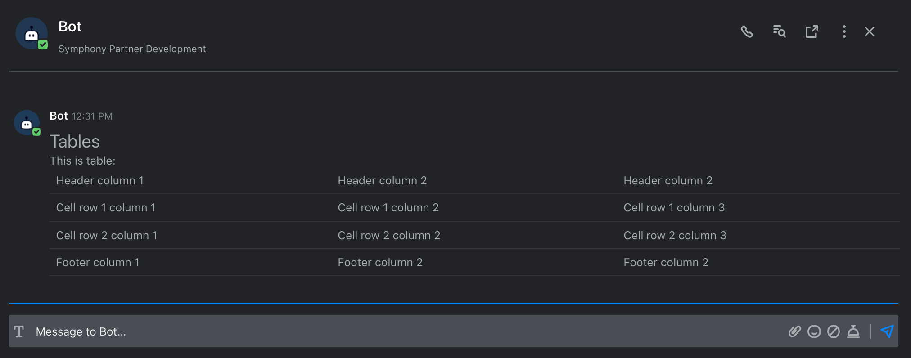
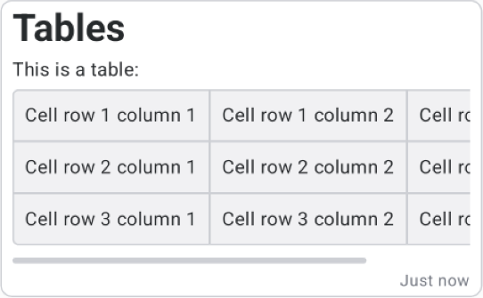

# Tables



## Tags

MessageML supports the following tags to arrange information within a message using tables:

| Tags                                                | Description                      | Optional attributes                                                                      |
| --------------------------------------------------- | -------------------------------- | ---------------------------------------------------------------------------------------- |
| `<table>` `<tr>` `<td>text</td>` `</tr>` `</table>` | Render "text" in a table format. | <p>• <em><code>class</code></em><br>• <code>rowspan</code><br>• <code>colspan</code></p> |
| `<thead>`, `<tbody>`, `<tfoot>`                     | Table sections.                  | • `class`                                                                                |

## Examples

Here after you can find an example of a message sent by a bot and containing table tags as well as the structure of the messageML sent:







```markup
<messageML>
    <h1>Tables</h1>
    <p>This is a table:</p>
    <table>
        <thead>
            <tr>
                <td>Header column 1</td>
                <td>Header column 2</td>
                <td>Header column 2</td>
            </tr>
        </thead>
        <tbody>
            <tr>
                <td>Cell row 1 column 1</td>
                <td>Cell row 1 column 2</td>
                <td>Cell row 1 column 3</td>
            </tr>
            <tr>
                <td>Cell row 2 column 1</td>
                <td>Cell row 2 column 2</td>
                <td>Cell row 2 column 3</td>
            </tr>
        </tbody>
        <tfoot>
            <tr>
                <td>Footer column 1</td>
                <td>Footer column 2</td>
                <td>Footer column 2</td>
            </tr>
        </tfoot>
    </table>
</messageML>
```





## Tags

MessageML supports the following tags to arrange information within a message using tables:


Supported on Android starting with the release of the Symphony Messsaging Mobile App v26.10. Support for iOS will be available in a later version.


## Sending Elements

| Tags                                                | Description                      | Optional attributes                                     |
| --------------------------------------------------- | -------------------------------- | ------------------------------------------------------- |
| `<table>` `<tr>` `<td>text</td>` `</tr>` `</table>` | Render "text" in a table format. | <p>• <code>rowspan</code><br>• <code>colspan</code></p> |

## Example

Message sent by a bot and containing table tags, as well as the structure of the messageML sent:







<pre class="language-markup"><code class="lang-markup">&#x3C;messageML>
    &#x3C;h1>Tables&#x3C;/h1>
    &#x3C;p>This is a table:&#x3C;/p>
    &#x3C;table>
        &#x3C;tr>
            &#x3C;td>Cell row 1 column 1&#x3C;/td>
            &#x3C;td>Cell row 1 column 2&#x3C;/td>
            &#x3C;td>Cell row 1 column 3&#x3C;/td>
        &#x3C;/tr>
<strong>        &#x3C;tr>
</strong>            &#x3C;td>Cell row 2 column 1&#x3C;/td>
            &#x3C;td>Cell row 2 column 2&#x3C;/td>
            &#x3C;td>Cell row 2 column 3&#x3C;/td>
        &#x3C;/tr>
          &#x3C;tr>
            &#x3C;td>Cell row 3 column 1&#x3C;/td>
            &#x3C;td>Cell row 3 column 2&#x3C;/td>
            &#x3C;td>Cell row 3 column 3&#x3C;/td>
        &#x3C;/tr>
    &#x3C;/table>
&#x3C;/messageML>
</code></pre>

<figure><figcaption></figcaption></figure>





