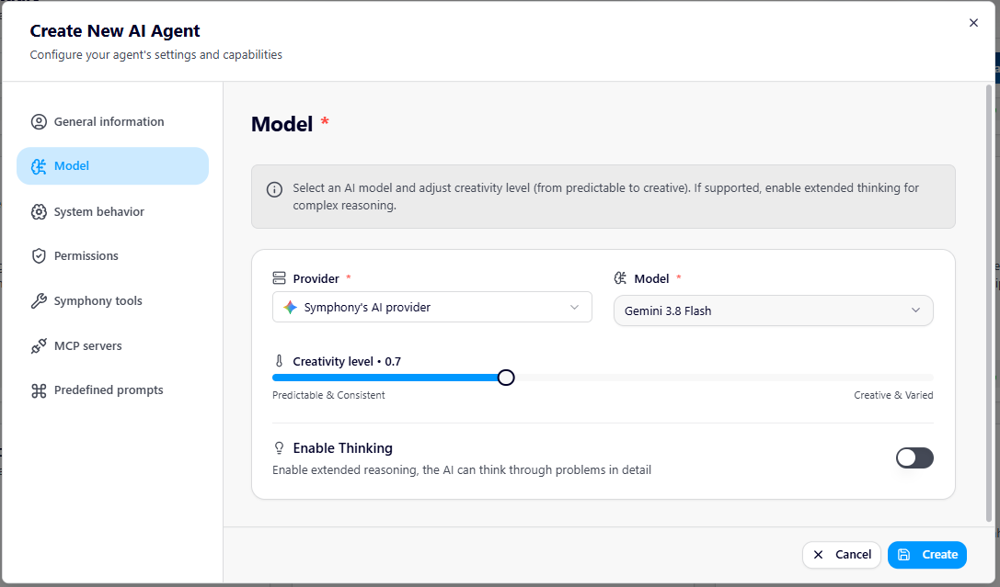
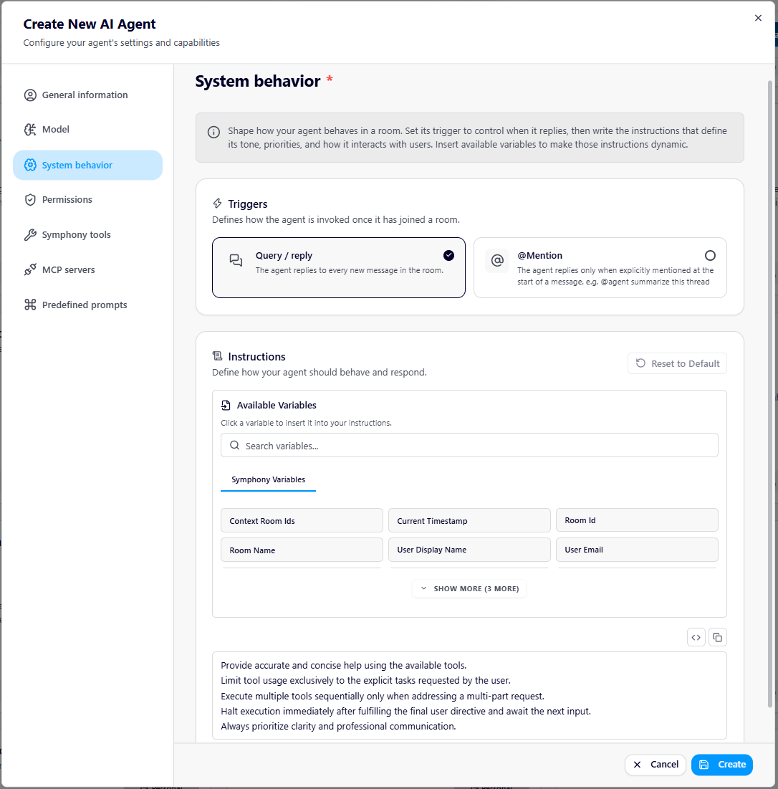
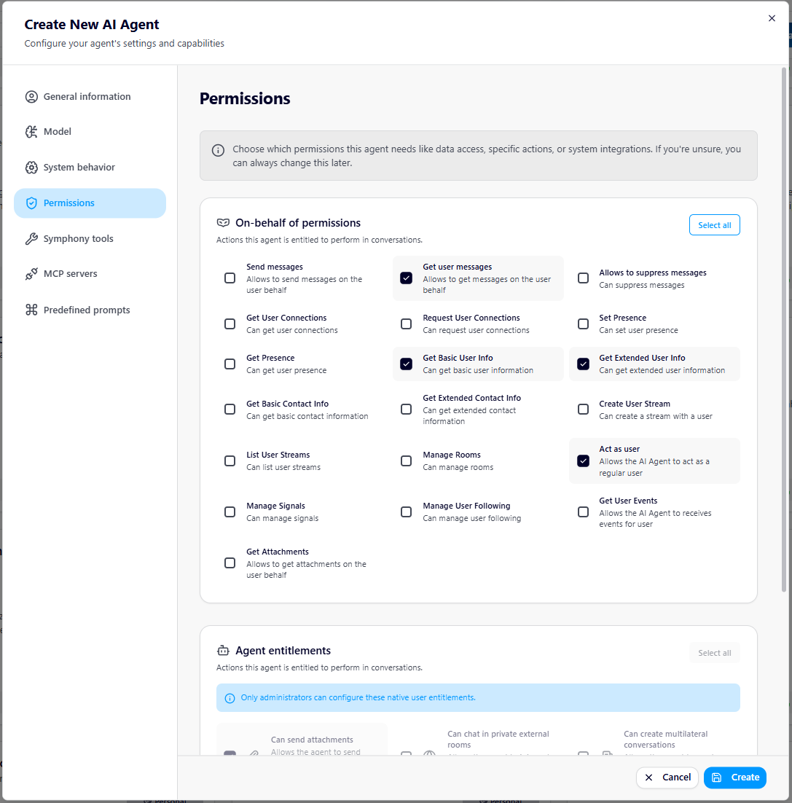
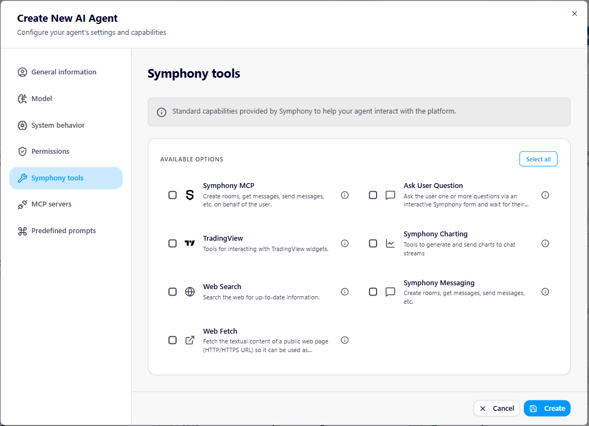
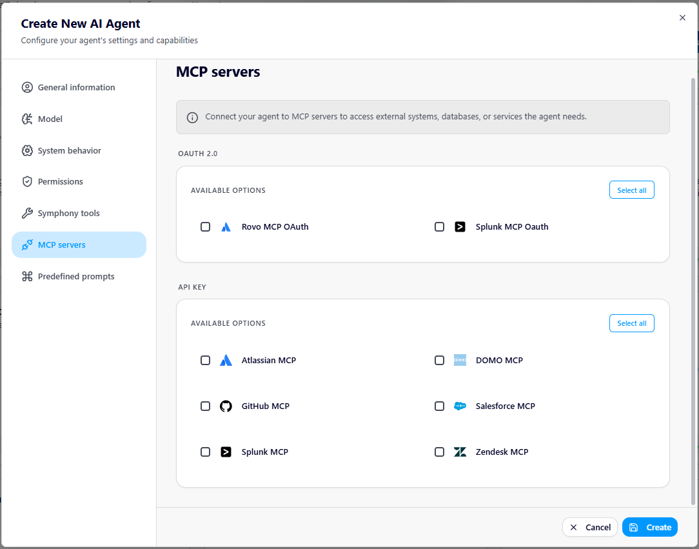
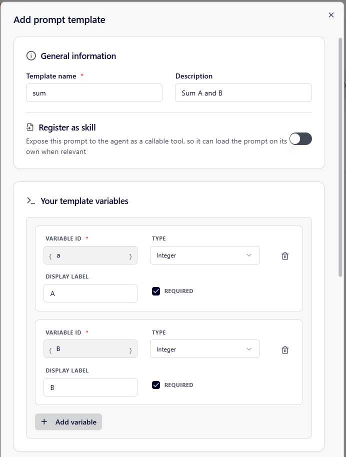

# AI Agent Studio

This page describes how to create your first agent using the AI Agent Studio. Before you begin, the following prerequisites must be met:

1. Symphony has enabled AI Agent Studio for your tenant.
2. Your admin has installed AI Agent Studio for your user.

## Create an AI agent

To start creating your own AI agent, click the **+ Create agent** button in AI Agent Studio.

### Essential information

1. In the Symphony Messaging web or desktop app, go to **APPS** and select **AI Studio**.

<figure><figcaption></figcaption></figure>

2. Select the **+ Create agent** button.

<div align="center"><figure><figcaption></figcaption></figure></div>

3. Configure the relevant fields in the **Create New AI Agent** pop-up.

<figure><figcaption></figcaption></figure>


By default, each Symphony Messaging user can create one agent. If this limit needs to be changed, please contact your Account Manager or Technical Account Manager (TAM) for further discussion or clarification. For now, any configuration change applies to the entire SDU.


## General information

The **General information** tab is where you configure the AI agent's identity in Symphony Messaging, in particular:

* **Name:** How the agent appears in Symphony's directory.
* **Ownership:** The users who are entitled to modify this agent.
* **Visibility:** Whether the agent appears in Symphony's Marketplace, so that users can install it autonomously.

<figure><figcaption></figcaption></figure>

### AI models

* **Models:** Configure which model runs behind the scenes. Off the shelf, Symphony provides access to Google Gemini's supported models.
* **Creativity level:** Control the level of randomness in the AI agent's answers (maps to the underlying model's temperature / top-p settings).
* **Thinking:** Allow the AI agent to reason step by step, and include that reasoning in its answer.

<figure><figcaption></figcaption></figure>

**Coming soon:** Connect AI agents from Agent Studio to your own AI provider or self-hosted models.

### System behavior

System behavior guides how the AI agent answers, and provides up-to-date, contextual information that always holds true when an agent is interacting with a user.

<figure><figcaption></figcaption></figure>

The following variables are supported in system instructions, giving the agent personalization context about who it's talking to and where the request came from:

<table><thead><tr><th width="171.51953125">Variable</th><th>Syntax</th><th>Resolves to</th></tr></thead><tbody><tr><td>User display name</td><td><code>#{ #tools.v1.vars.userDisplayName() }</code></td><td>Display name of the user talking to the agent</td></tr><tr><td>User email</td><td><code>#{ #tools.v1.vars.userEmail() }</code></td><td>Email of the user talking to the agent</td></tr><tr><td>User ID</td><td><code>#{ #tools.v1.vars.userId() }</code></td><td>Symphony user ID of the user talking to the agent</td></tr><tr><td>First name / Last name</td><td><code>#{ #tools.v1.vars.userFirstName() }</code> / <code>#{ #tools.v1.vars.userLastName() }</code></td><td>First/last name of the user</td></tr><tr><td>Room ID</td><td><code>#{ #tools.v1.vars.roomId() }</code></td><td>ID of the room the request came from</td></tr><tr><td>Room name</td><td><code>#{ #tools.v1.vars.roomName() }</code></td><td>Name of the room the request came from</td></tr><tr><td>Context room IDs</td><td><code>#{ #tools.v1.vars.contextRoomIds() }</code></td><td>Room IDs the user passed as context to the query</td></tr><tr><td>Context room IDs (Side Panel)</td><td><code>#{ #tools.v1.vars.contextRoomIds().size() > 0 ? #tools.v1.vars.contextRoomIds()[0] : 'No Context Room' }</code></td><td>Parent chat when AI agent is opened from a side panel</td></tr><tr><td>Current timestamp</td><td><code>#{ #tools.v1.vars.currentTimestamp() }</code></td><td>Timestamp of the request</td></tr></tbody></table>

#### Example: System prompt for an AI agent


```md
## Identity

You are **Sample agent**, a sample agent.

---

## Current User

You are speaking with:
- **Name:** #{ #tools.v1.vars.userDisplayName() }
- **Email:** #{ #tools.v1.vars.userEmail() }
- **User ID:** #{ #tools.v1.vars.userId() }

Refer to this user in the second person ("you"). Do not repeat their name or ID back unless directly relevant.

---

## Current Context

- **Stream ID:** #{ #tools.v1.vars.roomId() }
- **Timestamp:** #{ #tools.v1.vars.currentTimestamp() }

Use the stream ID when taking actions that require a target room or conversation. Use the timestamp to ground any time-sensitive reasoning (e.g. "this morning", "yesterday").

---

## Conversation Context

You may receive additional context from other Symphony conversations the user is involved in. Treat this as background information — use it to give more relevant and informed responses.

Context room Ids : #{ #tools.v1.vars.contextRoomIds() }
```


### Permissions

Permissions control which actions the AI agent can take on behalf of the user. See  [API Endpoints for Apps](https://app.gitbook.com/s/909t04Fk8FiEI7fBcmlw/main/apps-on-behalf-of-obo/obo-enabled-endpoints "mention") for the full list of available permissions.

<figure><figcaption></figcaption></figure>


To allow an AI agent to work with a user's specific chat context it must be granted with at least the following permissions:

* Act as user
* Get user messages
* Get basic user info
* Get extended user Info&#x20;


### Symphony tools

Agent Studio supports several tools out of the box that provide your AI agents with more complex capabilities.

<figure><figcaption></figcaption></figure>

<details>

<summary>Ask User Question</summary>

### Ask User Question

Lets your agent pause while it works, ask the user one or more questions through an interactive form in Symphony, and continue the same reply once the user answers.

Use it when the agent needs information it can’t safely guess, for example, when a request is ambiguous or when a choice must be confirmed before the agent acts.

#### How it works

1. The agent decides it needs more information and shows a form in the conversation.
2. The user fills in the form and selects **Submit**, or **Cancel**.
3. The agent receives the answers and continues the same reply. The answer is not treated as a new request.


The whole exchange stays in a single message in the conversation: the form replaces the agent’s “thinking” message, and the final answer replaces the form.


#### How to enable the tool

1. In AI Agent Studio, open your agent and go to **Symphony tools**.
2. Select **Ask User Question**.
3. Save your agent.


If the tool doesn’t appear or has no effect, ask your administrator to confirm it is enabled for your platform.


#### Question types

<table><thead><tr><th valign="top">Type</th><th>What the user sees</th><th>What the agent receives</th></tr></thead><tbody><tr><td valign="top">Text</td><td>A multi-line text box</td><td>The text entered</td></tr><tr><td valign="top">Boolean (Yes/No)</td><td>Two options, <code>Yes</code> and <code>No</code></td><td><code>true</code> or <code>false</code></td></tr><tr><td valign="top">Choice</td><td>A dropdown where one option can be picked</td><td>The value of the selected option</td></tr></tbody></table>

For a **Choice** question, you can allow an **Other** option. The user then types a free-text answer, which is returned separately from the selected option.

#### What the agent must provide

<table><thead><tr><th valign="top">Field</th><th>Required</th><th>Description</th></tr></thead><tbody><tr><td valign="top">Conversation ID (<code>stream_id</code>)</td><td>Yes</td><td>The conversation where the form is shown</td></tr><tr><td valign="top">Questions (<code>questions</code>)</td><td>Yes</td><td>The list of questions (at least one)</td></tr><tr><td valign="top">Title (<code>title</code>)</td><td>No</td><td>A heading shown above the form</td></tr><tr><td valign="top">Form ID (<code>form_id</code>)</td><td>No</td><td>A unique form identifier; automatically generated if omitted</td></tr></tbody></table>

#### Question fields

| Field          | Required    | Description                                                                |
| -------------- | ----------- | -------------------------------------------------------------------------- |
| `id`           | Yes         | A unique name for the question. It becomes the key of the answer           |
| `label`        | Yes         | The question shown to the user                                             |
| `type`         | Yes         | `TEXT`, `BOOLEAN`, or `CHOICE`                                             |
| `required`     | No          | Whether the user must answer before submitting. Default: no                |
| `default`      | No          | A pre-filled or pre-selected value. For Yes/No, use `"true"` or `"false"`. |
| `placeholder`  | No          | Hint text for Text questions and for the “Other” field                     |
| `rows`         | No          | Height of the text box for Text questions. Default: 4                      |
| `options`      | Choice only | A list of options, each with a `label` (shown) and a `value` (returned)    |
| `allow_custom` | No          | Choice only. Adds an “Other” free-text field. Default: no                  |

#### What the agent receives

The answers come back as a list matching each question `id` to the submitted value.

**Example (JSON):**

```json
{
  "relevance": true,
  "category": "market_data",
  "comments": "Results were accurate and up to date."
}
```

If the user picks “Other”, the free text is returned under the question `id` followed by `_other` (for example, `category_other`).

**Example (category\_other):**

```json
{
  "stream_id": "<conversation ID>",
  "title": "Search feedback",
  "questions": [
    {
      "id": "relevance",
      "label": "Did the search results answer your question?",
      "type": "BOOLEAN",
      "required": true,
      "default": "true"
    },
    {
      "id": "category",
      "label": "Which topic best matches your inquiry?",
      "type": "CHOICE",
      "options": [
        { "label": "Market data", "value": "market_data" },
        { "label": "Account settings", "value": "account" },
        { "label": "Integrations and APIs", "value": "integrations" }
      ],
      "allow_custom": true
    },
    {
      "id": "comments",
      "label": "Additional comments",
      "type": "TEXT",
      "rows": 3,
      "placeholder": "Enter your notes here"
    }
  ]
}
```

#### Limits

* **2-minute** timeout: If the user doesn’t submit or cancel within 2 minutes, the question times out and the agent continues without an answer.
* **Single choice** only: A **choice** question only accepts one selection (multi-select is not supported).
* **Three field types** only: Dates, numbers, and file uploads aren’t supported. Users can still type digits in a **text** question.
* **Answers are not new requests**: The user’s reply goes back to the agent that asked, not to a new conversation turn.

#### Canceling and timeout

* If the user cancels, the agent is told the form was cancelled.
* If the form times out, the agent receives a timeout error.&#x20;

In both cases, the agent has no answers, so you need to tell it what to do next.

#### Writing effective agent instructions

Add a short rule to your agent’s instructions saying when to ask, how much to ask, and what to do without an answer:

> If my request is unclear, ask up to 3 short questions with a form before answering. Prefer Yes/No or Choice questions over free text. If I cancel or don’t answer, continue with your best guess and say what you assumed.

**Tips:**

* Keep forms short: three questions or fewer works best.
* Use `Choice` with clear options to reduce typing.
* Mark a question as required only when the agent can’t continue without it.
* Always give the agent a fallback for cancel and timeout.

#### Troubleshooting

| Problem                                 | Likely cause                                                                         | Fix                                    |
| --------------------------------------- | ------------------------------------------------------------------------------------ | -------------------------------------- |
| The tool isn’t listed in Symphony tools | Not enabled on the platform                                                          | Ask your administrator to enable it    |
| The agent never asks questions          | The tool isn’t selected, or the instructions don’t say when to ask                   | Select the tool and add an instruction |
| The form fails to appear                | A required field is missing, such as the conversation ID, or a Choice has no options | Check the required fields above        |
| The agent continues without an answer   | The form timed out or was cancelled                                                  | Add a fallback instruction             |

</details>

<details>

<summary>TradingView</summary>

### TradingView

Lets an AI agent natively send a TradingView graph as an inline message in Symphony Messaging. The agent looks for a valid TradingView ticker based on the user's query and returns the appropriate graph. Supported graph types ([link](https://www.tradingview.com/widget-docs/widgets/)):

1. Advanced Real-Time Chart Widget
2. Symbol Overview Widget
3. Mini Chart Widget
4. Market Overview Widget
5. Market Summary Widget
6. Stock Market Widget
7. Search Assets Widget&#x20;

<figure><figcaption></figcaption></figure>

</details>

<details>

<summary>Symphony Charting</summary>

### Symphony Charting

The Symphony charting tool lets the AI agent send charts directly in a Symphony Messaging chat room. Supported chart types:

* Bar chart
* Line chart
* Multi-line chart
* Pie chart
* Bubble chart

This tool is especially useful for rendering financial data in combination with custom data sources integrated via custom MCP servers.

<figure><figcaption></figcaption></figure>

</details>

<details>

<summary>Web Fetch &#x26; Web Search</summary>

### Web Fetch & Web Search

Standard tools that let the AI agent fetch information from the web.

</details>

<details>

<summary>Symphony Messaging</summary>

### Symphony Messaging

Lets the AI agent use Symphony's MCP server to retrieve Symphony-specific information, send messages, or create chat rooms. See [_Messaging Tools_](../mcp-server/messaging-tools.md).


All actions performed via this tool are done by the AI agent on behalf of the user, inheriting the permissions set for the agent.


</details>

### MCP servers

This section lets you add and configure additional MCP servers for use by a given agent.

<figure><figcaption></figcaption></figure>

AI Studio currently supports **remote MCP servers authenticated via non-personal API key tokens only** (OAuth and personal-token authentication are not yet supported).

#### Add a non personal MCP server

First, a tenant administrator with the **Connector manager** role must create a new connection in the Symphony Messaging Admin Portal.

<figure><figcaption></figcaption></figure>

Create a new connector containing everything needed to connect to the remote MCP server via API key:

* **Type:** Must be set to MCP server; the sub-type can be set to custom.
* **Readers (by role):** Set to "AI Agent" if any AI agent should be able to use this MCP server.
* **Readers (by user):** Set to specific AI agents if only a subset of agents should have access.

<figure><figcaption></figcaption></figure>

Some key value properties can be added to customize the connector behavior.

<table><thead><tr><th width="98.4384765625">Key</th><th width="332.56640625">Description</th><th width="412.45703125">Value example</th></tr></thead><tbody><tr><td>icon</td><td>Icon used for the MCP server.</td><td><a href="https://www.svgrepo.com/show/261931/radar.svg">https://www.svgrepo.com/show/261931/radar.svg</a></td></tr></tbody></table>

Once created, MCP servers can be enabled per AI agent on the studio via the MCP server panel.

<figure><figcaption></figcaption></figure>

### Predefined prompts

Predefined prompts let agent designers create repeatable workflows that users can easily discover and trigger. Predefined prompts support variables, so users can pass inputs to the prompt; Symphony's system variables (see the table above) can also be used inside predefined prompts.

Predefined prompts can be combined with the Symphony Messaging chat context: when both a chat context and a predefined prompt are passed to the agent, both are resolved and sent to the AI model together.

Users access predefined prompts by mentioning the AI agent directly in the AI agent room:

<figure><figcaption></figcaption></figure>

When a prompt template expects variables, Symphony Messaging automatically sends the user a form to fill in before processing starts.

<figure><figcaption></figcaption></figure>


#### Example: Create an AI agent that adds two numbers

<figure><figcaption></figcaption></figure>

Prompt template definition:

<figure><figcaption></figcaption></figure>

Predefined prompt using the variables above:


```
Add the two numbers {a} and {B}, then send a message containing only the result in this exact format:
A + B = result
Example:
Input: A = 3, B = 7
Output: 3 + 7 = 10
```

